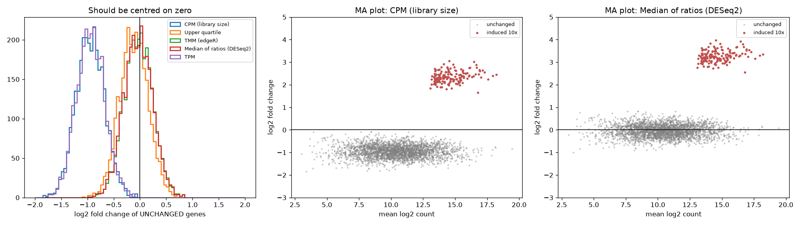

# RNA-seq Normalisation, Compared

> Your treated samples didn't downregulate 2,000 genes. One hundred and fifty genes went through the roof and ate the library.

## Demo Output



Produced from simulated counts by `demo.py`: fold changes of genes that did not change at all, under five normalisations, plus MA plots for CPM and DESeq2's median-of-ratios.

## Why This Exists

Normalisation is the step everyone copies from a tutorial and nobody checks. Every method makes an assumption. CPM and TPM assume total RNA output is the same in every sample. TMM and median-of-ratios assume *most genes don't change*. When a handful of genes are strongly induced, those assumptions give different answers, and only one of them is right. This repo simulates exactly that case and shows the damage.

## The Methods

| Method | Assumes | Good for | Bad for |
|--------|---------|----------|---------|
| CPM | Same total RNA per sample | Quick looks, filtering | DE with composition changes |
| TPM | Same total RNA, corrected for length | Comparing genes *within* a sample | Comparing samples |
| Upper quartile | The 75th-percentile gene is stable | Robust-ish quick fix | Low-depth or sparse data |
| TMM (edgeR) | Most genes not DE (trimmed, weighted) | Differential expression | Global shifts in expression |
| Median of ratios (DESeq2) | Most genes not DE (median) | Differential expression | Many zeros, global shifts |

## Usage

```python
from normalise import size_factors_median_ratio, size_factors_tmm
norm = counts / size_factors_median_ratio(counts)
```

## When NOT to Use This

- **Global transcriptional changes** (for example MYC amplification or transcriptional shutdown) break the "most genes don't change" assumption too. Use spike-ins.
- **Single-cell data.** Sparsity breaks median-of-ratios. Use pooling-based (scran) or model-based methods.
- **Production analysis.** Use DESeq2 or edgeR directly. This repo is for understanding what they do.

## The Uncomfortable Truth

TPM is a within-sample unit. If you're running differential expression on TPMs, the false "downregulated" genes in the demo are your genes too.

## Further Reading

- Robinson M. D. & Oshlack A. "A scaling normalization method for differential expression analysis of RNA-seq data." Genome Biology (2010).
- Anders S. & Huber W. "Differential expression analysis for sequence count data." Genome Biology (2010).
- Wagner G. P., Kin K. & Lynch V. J. "Measurement of mRNA abundance using RNA-seq data: RPKM measure is inconsistent among samples." Theory in Biosciences (2012).
